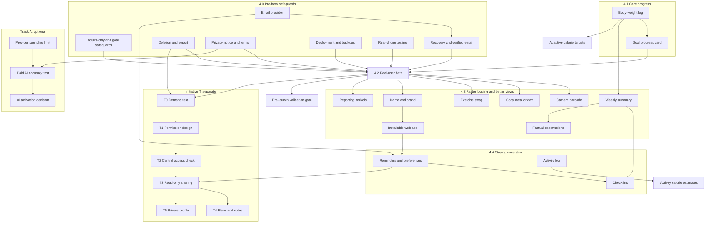

# Product Strategy

> **Synchronization note (2026-11-09):** Still a recommendation, but the owner has since approved UX-01 (2026-11-07), the beta capabilities and multi-gym (2026-11-08): see [DECISION_REGISTER.md](DECISION_REGISTER.md) §1. Its "confirmed missing" list is stale; see [FEATURE_INVENTORY.md](FEATURE_INVENTORY.md). Its open decisions are PS-Q1..12 there.

**Status: proposed, for independent review. Everything here is a recommendation, and nothing is approved for implementation.** Only the owner approves, one scope at a time, under [`DEVELOPMENT_WORKFLOW.md`](DEVELOPMENT_WORKFLOW.md). Full decision records are in [`FEATURE_DECISIONS.md`](FEATURE_DECISIONS.md).

**The main conclusion:** the app doesn't need many new features yet. It has strong logging, but can't yet responsibly hold real users' data, and it can't show the outcome many people care about: whether their weight is moving toward their goal. Fix those first. Then let real users, rather than this document, decide what comes next.

**A limit on all of this:** the project has no user research or usage data. Priorities here are reasoned judgement from inspecting the code, not evidence of what users want. Where a claim was checked in the code, it says so.

## 1. Product vision

FitWorkoutFoodTracker helps people plan and record workouts, track strength progression, track what they eat, monitor progress toward fitness goals, and understand the trends in their data. It may later let them work with a personal trainer they've authorized.

**Positioning: the tracker you can trust.** Other apps offer more automation. This one tells you where a number came from, and when it doesn't know.

**Principles:** accurate information, user control, privacy, practical usefulness, sustainable development, a simple experience, no invented nutritional information, and no misleading fitness calculations.

**Who it's for first:** one adult, aged 18 or over, tracking their own training and food on their own phone. Trainers are a potential later audience, preserved as a separate initiative.

**What it isn't:** medical advice, a coaching service, a social network, a public trainer marketplace, or a device-tracking platform.

## 2. Product Strategy Agent

Defined in [`.claude/agents/product-strategy-agent.md`](../.claude/agents/product-strategy-agent.md). It's the first review stage for every feature, gives an independent recommendation, and may challenge the owner, ChatGPT, Claude Code, existing architecture and this roadmap.

**Authority:** recommendations only. It can't authorize implementation, migrations, paid requests, deployment, merges or major architecture changes.

### How to invoke it

Tested on Claude Code 2.1.318 on Windows, in fresh non-interactive sessions (`claude -p`), with the agent file at commit `435ad21`.

| Syntax | Result |
|---|---|
| `@agent-product-strategy-agent Evaluate adding a daily water tracker with an eight-glass goal.` | **Worked once in `claude -p`.** The named agent ran and returned the required record. The main session made the call, so this doesn't show that the mention always bypasses its judgement. The interactive typeahead wasn't tested |
| `Use the product-strategy-agent subagent to ...` | **Worked once in `claude -p`.** The docs say Claude decides whether to delegate, so it may not always run |
| `claude --agent product-strategy-agent` | **Worked once with `-p`.** The session's tool list was only Read, Glob and Grep |
| Giving the file to another tool as instructions | Not tested. **Its access rules aren't enforced there** |

**A session started before the agent file existed can't find it.** The creating session returned "not found" every time, even after retrying. The docs say the first agent file in a new `.claude/agents` directory needs a restart.

### What has been verified, by kind of evidence

| Kind of evidence | What was done | Result |
|---|---|---|
| **Format validation** | Compared with the official docs. Parsed the frontmatter as YAML. Ran `claude plugin validate` on a copy | Matches the docs, and parses. The validator raised nothing about the agent file, though plugin agents ignore hooks, so it doesn't check them |
| **Direct hook tests** | Ran the hook command itself on sample JSON, in Git Bash and PowerShell. No files are opened | 12 of 12 allowed, 36 of 36 denied, and malformed input blocked, in both shells |
| **Live agent invocation** | The water tracker proposal, in a fresh session | The stream shows `subagent_type: product-strategy-agent`, and all 16 fields of the record are in the agent's own report |
| **Live hook enforcement: real agent** | Hook events captured during real runs | The hook fired on its tool calls and allowed approved paths. It blocked a real Glob at the project root with exit 2. **With `node` removed from `PATH`, it blocked both reads, including an allowed file** (exit 127), so a failed hook failed closed |
| **Live hook enforcement: identical copy** | See below | Blocked a path outside the allowlist, a traversal path, a file outside the project, secret names, a missing path and secret globs, each with exit 2 |

**Why a copy was needed:** when asked to attempt blocked files, the real agent declined, following its instruction never to try such files, so those calls never reached its hook. That's a useful first layer, but it isn't a hook test. So those calls ran through a temporary session-only agent, whose tools and hooks were taken from the real file and checked as equal, with no refusal instruction. **Blocking of secret names inside a real session is therefore verified on that copy, not on the named agent itself.**

**Not verified live:**

- **Malformed requests:** Claude Code sends well-formed input to hooks, so this was only tested directly.
- **`.db` files:** the Read tool refused one as binary before the hook ran, so that refusal isn't evidence about the hook. The `.db` rule was tested directly, and `.dump` and `.key` were blocked by the hook live.
- **A hook that hangs:** only a hook that couldn't start was tested, so the 10-second timeout path is untested.
- **An untrusted workspace:** this one is trusted. The docs say hooks are skipped until trust is accepted.
- **macOS and Linux,** and any other Claude Code version.

### What's enforced, and what isn't

| Control | How | Limit |
|---|---|---|
| Can't change files or run commands | Tool allowlist: Read, Glob and Grep only | Enforced by Claude Code |
| Can only read named project folders, and nothing that looks like a secret | A `PreToolUse` hook in the agent file, as an allowlist | A name-based rule: a secret with an ordinary name in an allowed folder isn't recognized |
| A hook that can't run | `onFailure: block`, and a deny decision alongside exit 2 | See "not verified live" |
| Hook is active | Claude Code runs a project agent's hooks only after the folder's trust prompt is accepted | **Per the docs, an untrusted folder runs the agent without its hooks** |
| Other agents and main sessions | Not covered: the hook applies only to this agent | Project-wide `Read` deny rules could cover them, which is open decision 12 |
| Files inside allowed folders | Grep and Glob are checked by the folder they're given, not per file | A secret placed inside `src/` or `scripts/` could be searched. None exist today, and those folders must stay free of them |
| Node.js | The hook needs `node` on the path | Without it, every tool call is blocked, so the agent can't work until it's fixed |
| Refusing to try secret files | An instruction in the agent | Observed working, but it's an instruction rather than an enforcement |

## 3. Feature inventory

Verified by reading the code at commit `64114bc`. "Tested" means automated tests with stubs, not real users.

| Area | Exists today | Where |
|---|---|---|
| **Accounts** | Sign-up, log-in, log-out, server-side sessions, login throttling | `api/auth/*`, `login-throttle.ts` |
| **Profile** | Date of birth, sex, height, one current weight, goal weight, goal, activity, units, time zone | `Profile`, `profile-form.tsx` |
| **Energy estimates** | BMR, TDEE and starting calorie target, labelled as estimates, with deficit caps and floors | `energy.ts` |
| **Exercise library** | 47 built-in exercises, plus custom ones, with muscle and equipment | `Exercise`, `exercise-picker.tsx` |
| **Plans and schedule** | Workout templates, weekly schedule | `WorkoutTemplate`, `ScheduleSlot` |
| **Workout logging** | Sets, warm-ups, previous performance per set, rest timer, notes, add and remove exercises mid-session, repeat a workout | `workout-logger.tsx` |
| **Session comparison** | Each exercise compared with its previous session, with reasons, and a session-by-session list per exercise | `compareToPrevious`, `history/[id]`, `progress/[exerciseId]` |
| **Personal records** | Heaviest weight, best est. 1RM, most reps, best session volume | `computeRecords`, in `overload.ts` |
| **Strength progress** | Overload status, per-exercise charts of weight, est. 1RM, volume and reps | `overload.ts`, `progress/*` |
| **Dashboard** | Today's workout, weekly completion, sets, volume and time, recent PRs | `dashboard/page.tsx`, `stats.ts` |
| **Food search** | Custom foods, USDA and Open Food Facts, typed barcode lookup, source and missing values shown | `foods/*`, `food-search.tsx` |
| **Food logging** | Meals, servings or grams, snapshots, safe retries | `FoodEntry`, `entries.ts` |
| **Targets** | Effective-dated calorie and macro targets | `NutritionTarget`, `targets-editor.tsx` |
| **Nutrition history** | Daily calories against target, weekly averages over logged days, protein consistency, 8-week trend | `nutrition/history`, `history-charts.tsx` |
| **Label scanning** | Photo to reviewed custom food. **Off without configuration** | `label-scanner.tsx`, `label-review.tsx` |
| **PDF labels** | Text read on the device, scanned pages through the AI path | `lib/pdf/*`, `pdf-page-picker.tsx` |
| **Meal photos** | AI suggests names only, and the person chooses a record and amount. **Off without configuration** | `meal-photo.tsx` |

**Partly built:**

- **Goal progress:** the goal and goal weight are stored, but only feed target suggestions. Nothing compares someone's state with their goal.
- **Weekly summaries:** the figures exist on separate screens, but nothing combines them.
- **Substitutions:** an exercise can be removed and another added, but there's no swap, and the replacement goes to the end.

**Confirmed missing, by searching `src/` and `public/`:** password reset, email verification, account deletion, data export, privacy pages, body-weight history, body measurements, goal safeguards beyond the suggestion floors, an app manifest or service worker, notifications of any kind, camera barcode scanning, saved meals, cardio or sport logging, any trainer or role concept, and exercise demonstrations.

**Documents that are out of date,** which future reviews should treat with care:

- `README.md` still describes Phases 1 and 2 only.
- `ARCHITECTURE.md` lists a different Phase 3, and plans an `AI_ESTIMATE` food source that the accuracy principles now forbid.
- `PHASE_3_DESIGN.md` still lists 3.6 as awaiting review.

## 4. Feature evaluation matrix

Summary only: every field is in [`FEATURE_DECISIONS.md`](FEATURE_DECISIONS.md). All are recommendations.

### Requested features

| Feature | Decision | Priority | Tier | Why, in brief |
|---|---|---|---|---|
| Progressive overload graphs | MODIFY | P2 | Post-MVP | Already built. Only needs a date range |
| Nutrition intake graphs | MODIFY | P2 | Post-MVP | Already built. Only needs a date range |
| Custom reporting periods | BUILD | P2 | Post-MVP | One shared control. Start with presets |
| Activity calorie estimates | POSTPONE | P3 | Future | Targets already include activity, so it double-counts |
| Personal trainer platform | POSTPONE, as Initiative T | P3 | Future | A potential major capability, with heavy prerequisites |
| Trainer accounts, relationships, programs, dashboards, feedback | MERGE into Initiative T | P3 | Future | One feature, reusing existing plans and views |
| Private trainer text profile | MERGE into Initiative T | P3 | Future | A basic private profile needs no marketplace |
| Private trainer photograph | POSTPONE | P3 | Future | The only part needing image storage |
| Public trainer discovery | POSTPONE | None | None | A separate business decision |
| Trainer marketplace and payments | REJECT for now | None | None | A different business, with financial regulation |
| Multiple gym locations | POSTPONE | P3 | Future | Custom exercises already handle it |
| AI equipment identification | REJECT | None | None | Paid AI to save one search, with wrong answers polluting history |
| Private equipment photographs | POSTPONE | P3 | Future | Optional. Would be the first stored images, and existing exercise notes cover most of the need |
| Android and iPhone apps | MODIFY | P1 testing, P2 install, P3 store | MVP testing; Post-MVP install; store apps Future | Test on real phones, then install. No native rewrite |
| Shared account synchronization | MERGE | None | Exists | Multi-device already works. Sharing one account between people: no |
| Front-and-back package scanning | MODIFY | P2 | Post-MVP | Back exists. Camera barcode is the real gap. Front scan adds little |
| Walking, running and sports | MODIFY | P2 | Post-MVP | A manual log, in its own table. No GPS or devices |
| Factual progress observations | BUILD | P2 | Post-MVP | Checkable facts from a person's own data, extending what exists |
| General exercise education | POSTPONE | P3 | Future | Needs a qualified person to own the content |
| Personalized health or training advice | REJECT | None | None | The app can't know enough to give it safely |
| Daily motivational quotes | REJECT | None | None | No practical use. A matter of taste the owner can overrule |
| Workout reminders | MERGE | P2 | Post-MVP | One reminder system. Try a calendar file first |
| Food logging reminders | MERGE | P2 | Post-MVP | Off by default, neutral wording |
| Progress check-in reminders | MERGE | P2 | Post-MVP | Needs the weight log first |
| Female scientist and dumbbell branding | MODIFY | P2 | Post-MVP | Settle the name, make it work as an icon, and avoid implying scientific verification |

### Features from the independent product review

Each was checked in the code. **Two of the ten listed as missing already exist, and three more are partly built.**

| Feature | Verified state | Decision | Priority | Tier |
|---|---|---|---|---|
| Bodyweight and measurement trends | Missing | MODIFY: weight first | P1 | MVP |
| Workout history comparison | **Built** for consecutive sessions | POSTPONE any addition | P3 | Future |
| Exercise substitutions | Partial | MODIFY: a swap action | P2 | Post-MVP |
| Workout personal records | **Built** | MERGE into summaries | None | Exists |
| Scheduled progress check-ins | Missing | MERGE: summary plus reminder | P2 | Post-MVP |
| Trainer-client permission management | Missing | MERGE into Initiative T | P3 | Future |
| Weekly progress summaries | Partial | MODIFY: combine what exists | P2 | Post-MVP |
| Goal progress dashboard | Partial | MODIFY: a card on the existing dashboard | P1 | MVP |
| Exercise demonstration references | Missing | POSTPONE | P3 | Future |
| Notification and reminder preferences | Missing | MERGE into reminders | P2 | Post-MVP |

## 5. Safety, eligibility and account protection

**All of this comes before any real user.** Details are in the "Adults-only eligibility and goal safeguards" record.

**Recommended initial eligibility: adults aged 18 and older.** The app uses adult formulas, and today it accepts ages from 13.

| Must be addressed | Why |
|---|---|
| 18+ stated before sign-up, and enforced at onboarding and on profile edits | Age is only checked at onboarding today, after the account exists. It's self-declared, so it can't be called verification |
| Any under-18 account found: block, notify, offer export, delete | Automated tests use adults, but no personal or production database was inspected for this review |
| "Not medical advice", and who the estimates aren't for | No such statement exists, and pregnancy, breastfeeding and medical conditions aren't handled |
| Warnings on manual targets below the floors, and on underweight goal weights | Manual targets go as low as 800 kcal, and goal weight has no height check |
| Somewhere to find help with eating concerns | Nothing addresses this today |
| Legal review of age rules, health-data status, consent and retention | Depends on the launch countries. **Not concluded here** |

**Account safety, in order:**

| Protection | Why it can't wait |
|---|---|
| Account recovery | A forgotten password currently means losing everything |
| Email verification | Recovery is only as good as the address, and a mistyped one locks someone out |
| Account deletion | People must be able to leave, with their data removed |
| Personal-data export | People must be able to take their data, and it's also the cheap test of trainer demand |
| Privacy notice and terms | People must know what happens to their data before they enter it |

## 6. Features to reject or postpone

**Reject:**

- **Trainer marketplace and payments:** a different business, for now.
- **AI equipment identification:** the person already knows the machine.
- **Personalized health or training advice:** can't be given safely.
- **Daily motivational quotes:** no practical use.

Several-person use of **one shared account** is also rejected, if that's what was meant.

**Postpone, with what reopens each:**

| Feature | Reopens when |
|---|---|
| Initiative T: personal trainer platform | Trainers commit to a pilot, or clients keep exporting reports for trainers, or the owner decides it's central |
| Public trainer discovery | A deliberate business decision |
| Trainer and equipment photographs | Storage is justified, and demand is shown |
| Activity calorie estimates | Users ask after using activity logging, with the display limits accepted |
| Multiple gym locations | Custom exercises prove too awkward |
| Front-of-pack scanning | Accuracy testing shows that back labels often fail to give a name |
| Store apps | Real-device testing finds a web limit that matters |
| AI scanning activation | Track A's test meets thresholds agreed beforehand. Retiring meal photos is a possible outcome |
| AI assistant | Users ask for what the screens can't answer |
| Progress photos | Strong demand, after the weight log exists |
| Plan import | Users or trainers ask |
| Adaptive calorie targets | The weight log has enough data |
| Exercise demonstrations and education | Beta users get stuck on technique, and a qualified person owns the content |
| Arbitrary session comparison | Beta users ask for it |
| Offline-tolerant logging | Real-gym testing shows it's common |

## 7. Proposed Phase 4 roadmap

**This is a proposal. No phase is approved.** Each sub-phase needs the owner's approval and the full workflow, and new tables need migration approval. The order is a recommendation: 4.0 and 4.1 could run in parallel, but both finish before 4.2.

**Tiers:** **MVP ESSENTIAL** is 4.0 to 4.2. **POST-MVP** is 4.3, 4.4 and the pre-launch gate. **FUTURE EXPANSION** is everything left. Track A and Initiative T sit outside this sequence.

**Not every feature belongs in the first release.** The first release is safe accounts, the existing logging, weight history and goal progress.

### Phase 4.0: Pre-beta safeguards (MVP ESSENTIAL)

| | |
|---|---|
| **Objective** | Real people could use the app responsibly and keep control of their data |
| **Included** | Adults-only eligibility and goal safeguards. Account recovery, email verification, deletion, export. Privacy notice and terms. Deployment with HTTPS on one instance. HSTS and proxy configuration. Tested database backup and restore. Basic error monitoring. Core flows on a real iPhone and Android phone. **AI stays off, with no key configured** |
| **Excluded** | New tracking features, AI activation, and full pre-launch validation |
| **Prerequisites** | Open decisions 1, 2 and 3. Legal review for the beta's country |
| **Architecture changes** | Token table (migration). Email provider, a recurring service needing approval. Monitoring. No new roles |
| **Security concerns** | Reset token handling, deletion completeness including backups, export scoped to the signed-in user, proxy configuration |
| **Acceptance criteria** | Someone under 18 can't complete sign-up. A locked-out person recovers their account. Deletion removes every row for that person, verified by test. A backup has actually been restored. Core flows pass on real phones |

### Phase 4.1: Core progress (MVP ESSENTIAL)

| | |
|---|---|
| **Objective** | Show progress toward the goal, which is what the beta most needs to test |
| **Included** | Body-weight log with a smoothed trend. A goal progress card on the existing dashboard |
| **Excluded** | Other body measurements, photos, adaptive targets, predicted goal dates, a new dashboard |
| **Prerequisites** | Open decision 8. Export and deletion must cover the new data |
| **Architecture changes** | One table with a `kind` column (migration) |
| **Security concerns** | Sensitive data: isolated per user, included in export and deletion, kept out of logs |
| **Acceptance criteria** | Trend and change come from the smoothed value, and are tested. Missing days don't read as zero. The card shows the right measure for each goal type, and no predicted dates |

### Phase 4.2: Real-user beta (MVP ESSENTIAL)

| | |
|---|---|
| **Objective** | Replace assumptions with evidence |
| **Included** | 5 to 10 adults, using it for a few weeks, on real phones, then a conversation with each |
| **Excluded** | Paid AI, trainers, public sign-up, analytics tooling |
| **Prerequisites** | **Phases 4.0 and 4.1 complete** |
| **Architecture changes** | None |
| **Security concerns** | This is the first real personal data. Participants get the privacy notice, and can leave and delete |
| **Acceptance criteria** | Findings are written up, and **this roadmap is revised from them.** Each Assumption in the decision register it affects is updated |

### Phase 4.3: Faster logging and better views (POST-MVP)

Extends what exists, and adds no parallel features. **To be re-ranked after the beta.**

| | |
|---|---|
| **Objective** | Less effort per log, and clearer trends |
| **Included** | Name and brand, installable web app, camera barcode, copy a meal or day, exercise swap, shared reporting periods, weekly summary, factual observations |
| **Excluded** | Store apps, front-of-pack scanning, full offline sync, measurements unless the beta asks |
| **Prerequisites** | Beta findings, and the name decided |
| **Architecture changes** | Manifest and possibly a minimal service worker. Possibly a barcode library, needing approval. No schema change expected for the rest |
| **Security concerns** | No personal data in service worker caches without a design for it. Camera frames stay on the device |
| **Acceptance criteria** | Installs on real phones. A barcode reads on real packaging, with a fallback. A copied entry keeps its source and missing values. Summaries reuse existing calculations, and say how many days were logged. Observations are facts with a named period |

### Phase 4.4: Staying consistent (POST-MVP)

| | |
|---|---|
| **Objective** | Help people keep going, and record training beyond lifting |
| **Included** | Calendar file first. Then, if needed, one opt-in reminder system with its preferences, including check-ins. Manual activity log |
| **Excluded** | Activity calorie estimates, GPS, wearables, streak pressure, quotes |
| **Prerequisites** | Installable app or email. Weight log and weekly summary, for check-ins |
| **Architecture changes** | Activity table, reminder settings, push subscriptions, the first background job. Each needs approval |
| **Security concerns** | No weights or calories in notification text. Subscriptions removed on deletion |
| **Acceptance criteria** | Every reminder is off by default, and can be turned off in one tap. It arrives at the right local time across a daylight-saving change. Activity entries don't affect volume, PRs or overload |

### Pre-launch validation gate (POST-MVP)

**Required before opening to the public, and separate from the pre-beta safeguards.** Depending on what's turned on, it may also need Track A.

| Pre-beta (Phase 4.0) | Pre-launch (this gate) |
|---|---|
| Eligibility and goal safeguards | Full legal review for each market, and ODbL attribution check |
| Recovery, verification, deletion, export | Dependency security review, including the Prisma 7 decision |
| Privacy notice and terms | Full security headers, including CSP, tested in all browsers |
| HTTPS, one instance, proxy configuration | Memory measured on the target Linux host, and Node version pinned |
| Backup restored once | Monitoring and alerts with an on-call plan, and log retention |
| Basic error monitoring | Multi-instance decision, and rate limits on creating foods and entries |
| Core flows on real phones | Wider real-device testing, and real-PDF compatibility if PDFs are offered |
| | Accessibility review, trademark check, and ESLint decision |

### Track A: Paid AI activation (optional, its own decision)

| | |
|---|---|
| **Objective** | Decide with measurements whether to switch on scanning. **The product must be worth using without it** |
| **Included** | Paid accuracy, injection and cost tests on real labels, meals and PDFs, against thresholds agreed first. Then enable, limit or retire each feature separately |
| **Excluded** | Any new AI feature |
| **Prerequisites** | Provider spending limit, privacy notice naming the provider, **explicit approval of paid requests**, and open decisions 9 and 10 |
| **Architecture changes** | None expected. Durable budget tracking, if traffic warrants it |
| **Security concerns** | Real prompt-injection results, photos going to a third party, budget surviving restarts |
| **Acceptance criteria** | Per-field accuracy published in the docs. Per-scan cost measured. A written decision for label scanning and for meal photos separately. "Don't activate" is an acceptable outcome |

### Priority order

1. Age and safety decision: small, and it shouldn't wait.
2. Account recovery and verified email.
3. Account deletion and data export.
4. Privacy notice, terms, deployment, backups, and real-phone testing.
5. Body-weight log and trend.
6. Goal progress card.
7. Real-user beta, then revise this list.
8. Name and brand, then the installable app.
9. Camera barcode, and copy a meal or day.
10. Weekly summary, reporting periods, observations and exercise swap.
11. Calendar file, then reminders with preferences if needed. Manual activity log.
12. Pre-launch validation.
13. Track A and Initiative T: separate decisions, at any point after the beta.

## 8. Initiative T: personal trainer platform

**A potential major product capability. Preserved, not scheduled, and not to be implemented yet.** This is outside the Phase 4 sequence, and it gets its own product review before each stage.

**Scope boundary:** a private relationship between a client and a trainer they invited. Public discovery, marketplace and payments are separate decisions, not part of it.

### Prerequisites

**Product:**

- Pre-beta safeguards complete, and real users on the app.
- Evidence of demand, from the export test or trainers committing to a pilot.
- Owner decisions on business model and liability.

**Permission model, designed before any code:**

- The client always initiates or accepts, and no trainer can add a client alone.
- Access is by category: workouts, nutrition, body data. Body data and nutrition are off until chosen.
- Read-only by default. Writing is limited to proposing plans and adding notes, and a proposed plan is a copy the client accepts.
- Revocation is immediate, and a trainer holds no copies afterward.
- The client can see what's shared, with whom, and an access log.
- A relationship ending, or either account being deleted, has defined results.

**Authorization:**

- Today every query filters directly on `userId`, across many files. This needs one central access check, used by every data route.
- A trainer's session must never reach another user's data except through that check.
- A test for every route against every permission combination, including revoked access, and with negative controls.
- Existing cross-user protections stay as they are for ordinary users.

**Privacy and legal:**

- Legal review of sharing health-adjacent data, for each market.
- Consent records, and retention rules for audit logs.
- Trainer profiles and client relationships included in export and deletion.
- Terms covering liability for programs and advice, and qualifications labelled self-reported.
- Adults only, on both sides.

**Infrastructure:** verified email and notifications, for invitations and for telling clients about access.

### Stages

| Stage | Contents | Gate to continue |
|---|---|---|
| T0: Demand test | Data export used to share with a trainer. Conversations with real trainers | Evidence of real demand |
| T1: Design | Permission model, threat model, legal review. **No code** | Reviewed and approved |
| T2: Authorization foundation | The central access check, with no user-visible change | Full route-by-permission tests pass |
| T3: Read-only sharing | Invitation, consent, revocation, access log, read-only Progress views | Pilot with real trainers and clients |
| T4: Plans and notes | Trainer-proposed plans as copies, and notes on sessions | Pilot shows that it's used |
| T5: Private profile | Text first. Photo only if storage is justified | |

**Until then, one low-cost rule:** new features should keep their ownership checks clear, and shouldn't add sharing of any kind. Don't add roles or permission tables early, as nothing would use them.

## 9. Feature dependency map

An arrow means "must come before". This shows recommendations, not approved work.

**The main thing this shows:** everything flows through the beta, and the beta needs the account protections first. Trainer work sits at the end of the longest chain, so it can't sensibly come early.

## 10. Development workflow

Every new feature follows the cycle in [`DEVELOPMENT_WORKFLOW.md`](DEVELOPMENT_WORKFLOW.md): product strategy review, feature approval, architecture review, security and privacy review, implementation, automated testing, GitHub source review, merge approval, merge. Every proposal gets an independent recommendation, and major scope changes return to product review. `CLAUDE.md` makes this the standing instruction for future sessions.

## 11. Remaining strategic disagreements

Recorded so reviewers can weigh them. **The owner decides.**

| Topic | The view being challenged | The agent's position |
|---|---|---|
| Features listed as missing | The product review listed personal records and history comparison as missing | Both exist. Nothing new should be built for them now |
| Exercise demonstrations | Listed as a missing feature | Postpone. It's a content product, with an owner and upkeep. A search link is enough for now |
| Trainer profiles | Basic profiles don't need a marketplace | **Agreed, and the earlier rejection was too broad.** But a pilot may need only a name, and photographs remain hard to justify |
| Equipment photographs | Worth evaluating as an optional private feature | Agreed that it's separate from AI. Still postponed: a note covers most of the need, at no storage cost |
| Trainer platform | Preserve as a potential major capability | Preserved. It stays behind a demand test, unless the owner decides that it's central |
| Motivational quotes | Requested by the owner | Rejection stands, though this is a matter of taste |
| Email verification before beta | A prerequisite | Accepted. A very small invited beta could arguably do without it, but it's small to add alongside recovery |
| AI scanning | Phase 3 built it at considerable effort | That effort isn't a reason to switch it on. Meal photos in particular must show that they save time |

## 12. Open product decisions

For the owner. Each changes what gets built.

| # | Decision | Recommendation | Why it matters |
|---|---|---|---|
| 1 | **Confirm 18 as the minimum age** | Yes, subject to legal review | Adult formulas give teenagers deficit targets |
| 2 | **Which countries for the beta and launch?** | Start with one, chosen deliberately | Determines privacy law, health-data rules and consent |
| 3 | **Host and email provider** | Decide in Phase 4.0. Recurring costs need approval | Blocks deployment and account recovery |
| 4 | **Product name:** "Forge" in the app, FitWorkoutFoodTracker elsewhere | Choose one, after a trademark check | Needed before an icon or store listing |
| 5 | **Is this a business?** Free, paid, or a personal project | Decide before Track A and Initiative T | AI and trainers have ongoing costs that need paying for |
| 6 | **What did "shared account" mean?** | Clarify: multiple devices already work | A family plan would be a different feature |
| 7 | **Is the trainer platform central to your plans?** | If it is, start Initiative T's demand test right after the beta | Changes its timing, but not its prerequisites |
| 8 | **How does the weight log relate to `currentWeightKg`?** | The latest log entry becomes current weight, and targets stay manual unless accepted | It feeds calorie suggestions |
| 9 | **AI acceptance thresholds** | Set them before any paid test | Prevents justifying the results afterward |
| 10 | **Is paid AI wanted at all?** | Decide after the beta | The rest of the roadmap doesn't depend on it |
| 11 | **Who would own exercise and safety content?** | A qualified person, if any such content is wanted | No educational content, or eating-concern guidance, without one |
| 12 | **Add project-wide `Read` deny rules for secrets?** | Yes, in `.claude/settings.json`, as a separate small change | The agent's hook covers only that agent. The docs describe deny rules' coverage of Grep and Glob as best-effort, so they add to the hook and don't replace it |
